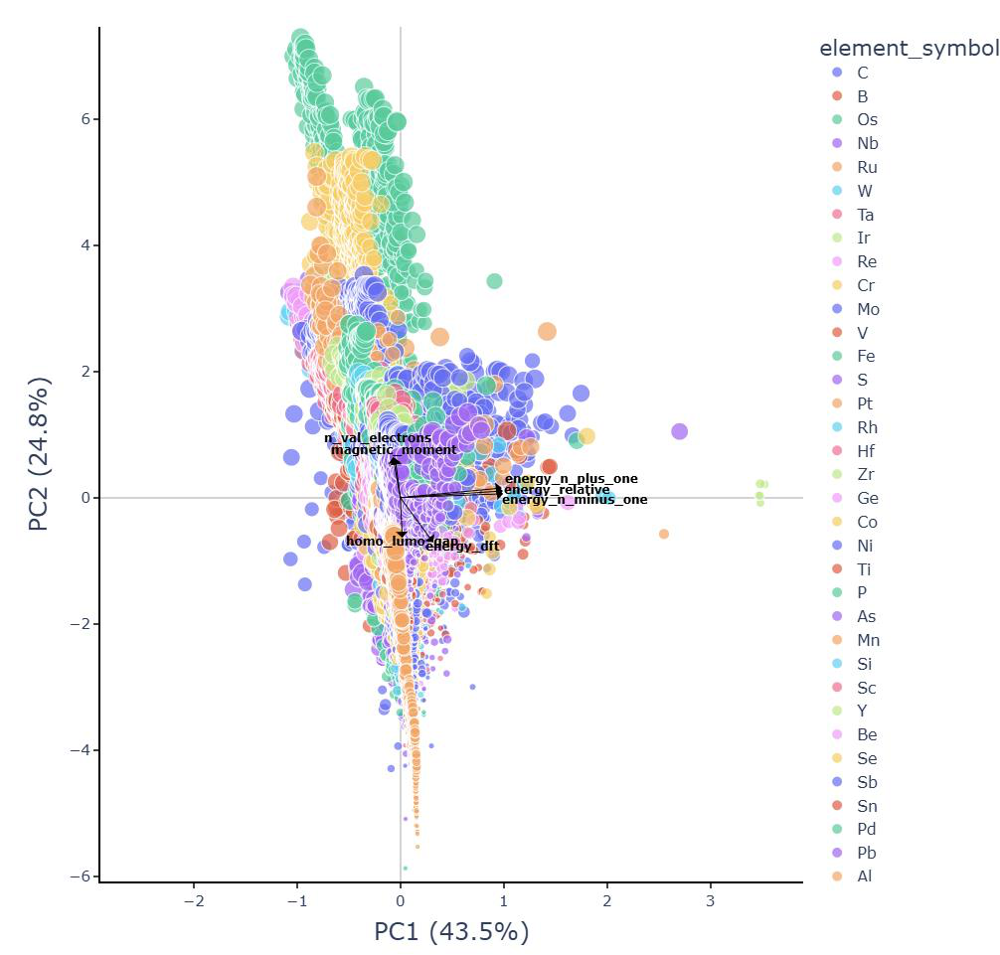
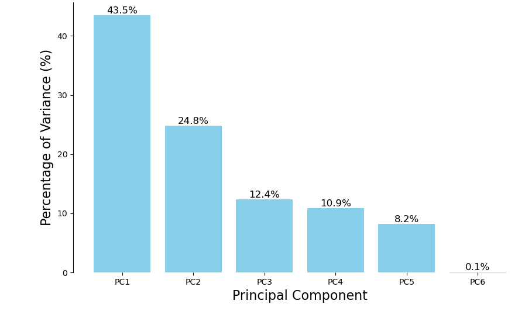
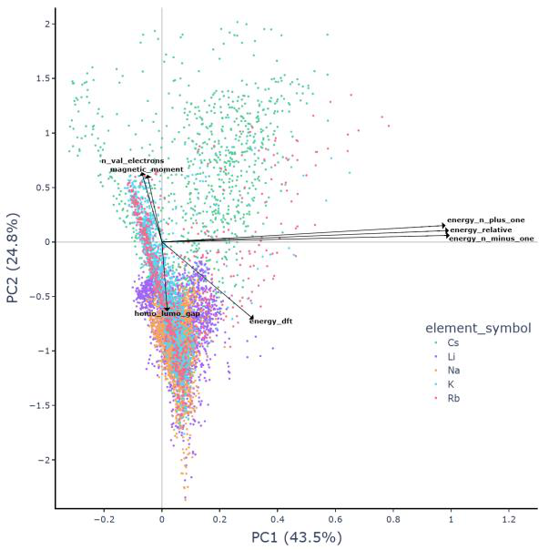
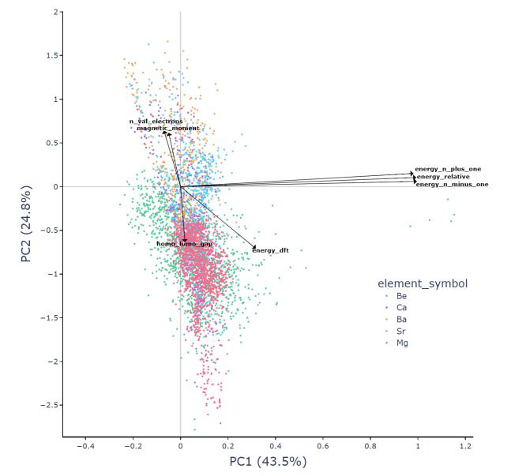
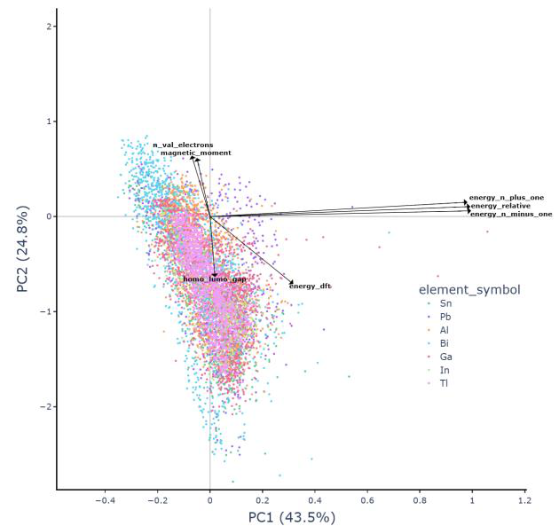
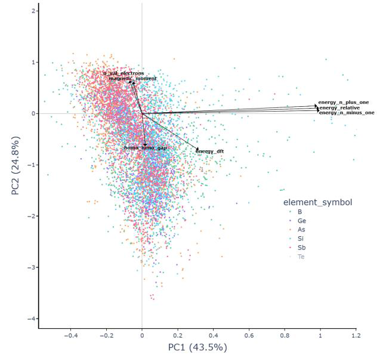
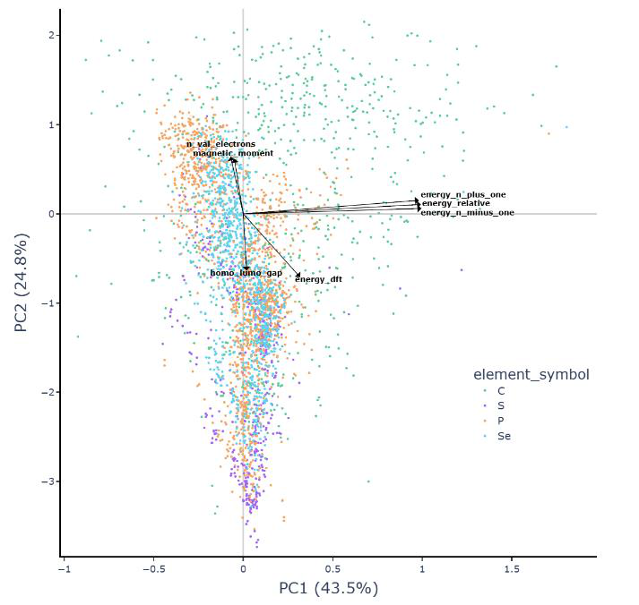
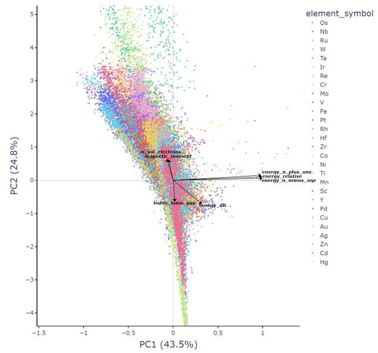
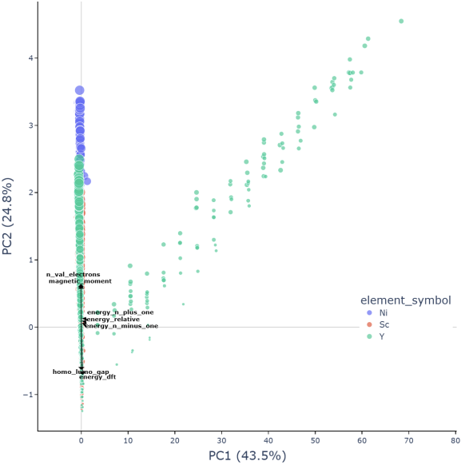

# Nanocluster Data Analysis

How do nanoclusters of different elements compare when their energy and electronic properties are considered together? This project uses principal component analysis (PCA) to map structures from the Quantum Cluster Database onto two shared axes. The original analysis began with 63,015 structures across 55 elements and retained 60,553 after removing incomplete records.

## A map of nanocluster properties



Each point represents one calculated structure. Colour identifies its element, and larger markers represent clusters with more atoms. The black arrows show the directions in which the original properties increase. Atom count was held out of the model so its relationship with the PCA scores could be inspected visually.

**PC1 explains 43.5% of the variance and PC2 explains 24.8%.** Relative energy and the two neighbouring-size energy measures point strongly along PC1. Magnetic moment and valence electron count point upward on PC2, while the HOMO–LUMO gap points downward. Together the two axes capture 68.3% of the variation in the seven standardised properties. Distances in this view describe similarity in those properties. They do not establish a ranking of experimental stability.



## Comparing element families

All panels use scores from the same fitted model. Their axis limits differ, so compare the tick values when judging the spread. The alkaline earth metals occupy a narrow band along PC1, while the metalloid structures span a wider range of energy profiles.

| Alkali metals | Alkaline earth metals |
| --- | --- |
|  |  |
| **Post-transition metals** | **Metalloids** |
|  |  |
| **Nonmetals** | **Transition metals, detail** |
|  |  |

### Why yttrium stands out



The zoomed transition-metal panel shows a dense band near PC1 = 0. On the wider axis above, a subset of yttrium (Y) structures forms a separate diagonal branch, extending well beyond nickel (Ni) and scandium (Sc). The original report flagged Y clusters of roughly 10–20 atoms for closer inspection. Comparing their geometries with other Y structures of the same size would help investigate the pattern.

## Run the analysis

Download **data.csv** from the [Quantum Cluster Database](https://muellergroup.jhu.edu/qcd/). From the repository root, run the following commands in a terminal. The original coursework used the filename `Nanoclusterdata.csv`. Either filename works when passed as the argument.

```bash
python -m venv .venv
source .venv/bin/activate
python -m pip install pandas numpy matplotlib scikit-learn seaborn
python nanocluster_analysis.py data.csv --output results
```

The script fits six components after standardising seven CSV columns: `energy_n_minus_one`, `energy_n_plus_one`, `homo_lumo_gap`, `n_val_electrons`, `magnetic_moment`, `energy_dft` and `energy_relative`. It also reads `element_symbol` and `n_atoms` for plotting. Rows with missing values in these nine fields are excluded. The terminal reports the retained row count and the variance explained by PC1 and PC2 for the supplied CSV.

The figures in `images/` are the original report figures. The command above writes fresh PNGs to `results/`. To refresh the figures embedded in this README, use `--output images`. Regenerated charts use Matplotlib and can differ in styling. Add `--eda` to also generate property distributions, element counts, DFT-energy violin plots, a correlation heatmap and a scatter matrix.

## Data reference

Manna, S. et al. (2023). *A database of low-energy atomically precise nanoclusters*. Scientific Data, 10, 308. [Read the paper](https://doi.org/10.1038/s41597-023-02200-4).
